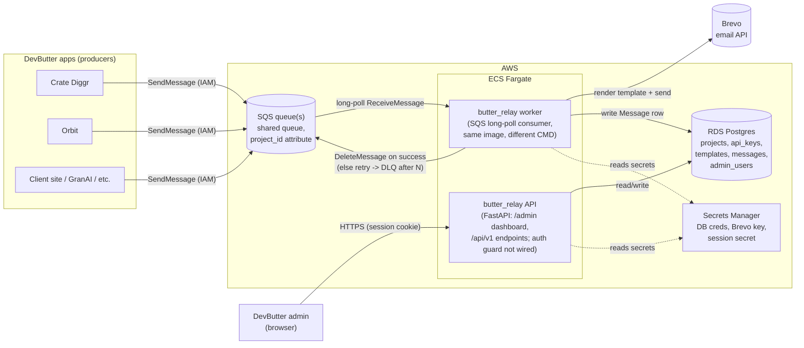
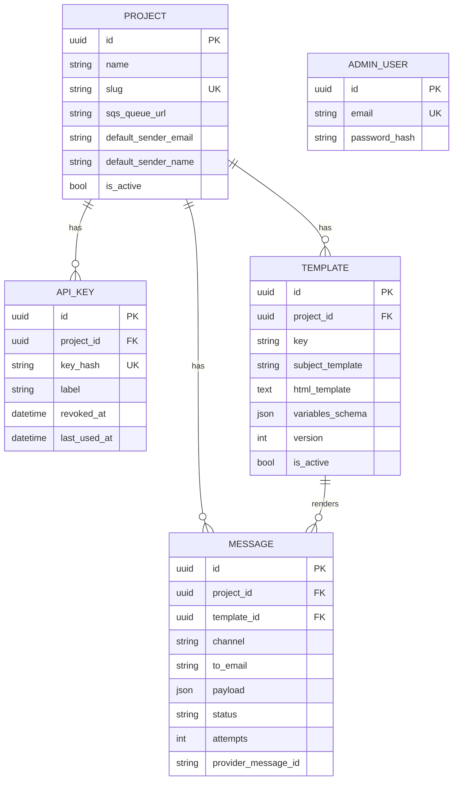

# Butter Relay

DevButter's company-wide, multi-tenant transactional email service. Apps publish "send this email" jobs to an SQS queue; Butter Relay consumes them, renders a versioned Jinja2 template, dispatches through Brevo, and logs every attempt. A server-rendered admin dashboard lets the team manage projects, API keys, templates, and the message log without touching the database directly.

- **Multi-tenant**: one deployment serves every DevButter app/client (Crate Diggr, Orbit, GranAI, client sites, ...), each scoped as a `Project`.
- **Queue-driven**: AWS SQS in production, [ElasticMQ](https://github.com/softwaremill/elasticmq) (SQS-API-compatible) in local dev — same `boto3` client code either way.
- **Email-only for now**: `Message.channel` defaults to `"email"` and is reserved for a future `in_app`/`push` channel, but no other delivery mechanism is built.
- **Provider**: [Brevo](https://www.brevo.com/) today, behind an `EmailProvider` protocol. Amazon SES is the documented next implementation (IAM-authenticated, no separate API key) since deployment targets AWS.
- **Dashboard**: FastAPI + Jinja2 + HTMX, same Docker image and service layer as the API — no separate frontend build.

## Architecture

The current-state flow and security review is documented in
[`docs/butter-relay-fluxos.md`](docs/butter-relay-fluxos.md), with standalone Mermaid sources in
[`docs/diagrams/`](docs/diagrams/). The deployment shape below is descriptive; it is not proof
that AWS IAM, DLQ, Secrets Manager or provider configuration exists in the current environment.



### Message flow (sequence)

```mermaid
sequenceDiagram
    participant App as Producer app
    participant SQS as SQS queue
    participant W as Relay worker
    participant DB as Postgres
    participant Brevo as Brevo API

    App->>SQS: SendMessage(project_id attribute, template_key, to, payload)
    W->>SQS: ReceiveMessage (long poll)
    SQS-->>W: message + ReceiptHandle
    W->>DB: load Project + active Template
    W->>DB: insert Message(status=pending)
    W->>W: validate schema and render subject/html
    W->>DB: update Message(status=processing, attempts += 1)
    W->>Brevo: send email
    alt success
        Brevo-->>W: 201 + provider_message_id
        W->>DB: update Message(status=sent)
        W->>SQS: DeleteMessage
    else failure
        Brevo-->>W: error
        W->>DB: update Message(status=failed, last_error)
        Note over W,SQS: retry creates another Message row;<br/>DLQ requires external redrive policy
    end
```

Source files for both diagrams live in [`docs/diagrams/`](docs/diagrams/) (`architecture.mmd`, `message-flow-sequence.mmd`).

### Data model



`Template(project_id, key, version)` is unique — publishing a new version deactivates the prior active one. `ApiKey.key_hash` and `Project.slug` are also unique; violations surface as HTTP `409`.

## Tech stack

| Layer | Choice |
|---|---|
| Framework | FastAPI (async), Poetry-managed |
| Persistence | SQLAlchemy 2.0 (async) + Alembic, Postgres |
| Queue | AWS SQS (prod) / ElasticMQ (local dev), via `boto3` |
| Templates | Jinja2 `SandboxedEnvironment` (template bodies are user-authored content) |
| Email provider | Brevo (`core/email_provider.py`, `EmailProvider` protocol) |
| Dashboard | Jinja2 + HTMX, session-cookie auth (`bcrypt` + `itsdangerous`) |
| Testing | `pytest` + `httpx.AsyncClient`, in-memory SQLite |

## Project structure

```
app/
├── main.py                # FastAPI() wiring: middleware, exception handlers, routers
├── settings/               # config.py (env), logging_config.py, middleware.py
├── core/                   # dependencies.py, decorators.py (log_call/log_errors),
│                           # exceptions.py (self-registering handlers), email_provider.py
├── db/                     # base.py, session.py, all_models.py (for Alembic autogenerate)
├── projects/                # router/schemas/models/service/repository/dependencies
├── api_keys/                 # scoped credentials per project (+ CurrentApiKey auth dep)
├── templates_/                # email templates (subject + Jinja2 html body, versioned)
├── messages/                  # one row per send attempt = the email log
├── auth/                       # AdminUser, login/logout, session dependency
├── admin/                       # Jinja2+HTMX dashboard (router.py + templates/)
└── worker/                       # SQS consumer entrypoint (python -m app.worker)
alembic/                    # migrations
docs/diagrams/              # .mmd sources for the diagrams above
scripts/curl_smoke_test.sh  # end-to-end curl smoke test
tests/                      # pytest suite
```

Each domain package (`projects`, `api_keys`, `templates_`, `messages`, `auth`) follows the same six-file shape: `router.py`, `schemas.py`, `models.py`, `service.py`, `repository.py`, `dependencies.py`. `dependencies.py` holds the domain's DI wiring — `get_*_service` factories + their `Annotated[..., Depends(...)]` aliases, plus the auth deps the domain owns (`auth/` owns `CurrentAdminUser`/`CurrentAdminUserApi`; `api_keys/` owns `CurrentApiKey`). A domain that needs another's DI imports from `app.<owner>.dependencies`, never from `app.<owner>.router`; `core/dependencies.py` keeps only `DbSession`.

## Step-by-step: run it locally

### 1. Prerequisites

- Docker + Docker Compose
- (optional, for running things outside Docker) Python 3.11 and [Poetry](https://python-poetry.org/)

### 2. Configure environment

```bash
cp .env.example .env
```

The shared development PostgreSQL is started by `../infra/docker-compose.yml` as `shared-postgres`.
The defaults already point at `shared-postgres` and `elasticmq`. Set `BREVO_API_KEY` if you want real
sends instead of an expected `401`.

### 3. Bring up the stack

```bash
docker compose --profile dev up -d --build
```

The shared development PostgreSQL is started from `../infra/docker-compose.yml`. This stack starts
the ElasticMQ, API, and worker containers:

| Service | Purpose | Local port |
|---|---|---|
| `elasticmq` | SQS-compatible queue for local dev | `9324` |
| `mailpit` | SMTP server and web UI for local emails | `1025`, `8025` |
| `api` | FastAPI app (dashboard + JSON API), auto-reload | `8010` → `8000` |
| `worker` | SQS long-poll consumer | — |

Check everything is up:

```bash
docker compose ps
curl -s http://localhost:8010/health
```

Mailpit: http://localhost:8025

### 4. Apply the database migration

```bash
docker compose exec api alembic upgrade head
```

(Or from the host, if you have Poetry installed and Postgres reachable on `localhost:5436`:
`DATABASE_HOST=localhost DATABASE_PORT=5436 DATABASE_USER=relay DATABASE_PASSWORD=relay DATABASE_NAME=relay poetry run alembic upgrade head`)

### 5. Create the first admin user

There's no public self-registration endpoint (closed API) — bootstrap one via the running container:

```bash
docker compose exec -T api python -c "
import asyncio
from app.auth.repository import AdminUserRepository
from app.auth.service import AuthService
from app.db.session import session_factory

async def main():
    async with session_factory() as session:
        await AuthService(AdminUserRepository(session)).register(
            'admin@devbutter.com', 'Test@123'
        )

asyncio.run(main())
"
```

### 6. Log into the dashboard

Open [http://localhost:8010/admin](http://localhost:8010/admin), sign in with the credentials from step 5, then:

1. **Projects** → create a project (name, slug, `sqs_queue_url`, default sender). For local dev, an ElasticMQ queue URL looks like `http://elasticmq:9324/000000000000/relay-shared`.
2. Open the project → **Generate key** to create an API key (shown once — copy it).
3. Still on the project page → **Publish new version** to create a template (Jinja2 `subject_template` + `html_template`, e.g. `Welcome, {{ name }}!`).
4. **Messages** shows the log of every send attempt, with a filter by project/status and a **Resend** action on failed messages.

### 7. Send a test message through the queue

Producer apps publish to SQS directly (IAM-authorized, not via the dashboard). To simulate one locally against ElasticMQ:

```bash
PROJECT_ID="<uuid from step 6>"

docker compose exec -T api python -c "
import boto3, json
sqs = boto3.client('sqs', region_name='us-east-1', endpoint_url='http://elasticmq:9324',
                    aws_access_key_id='x', aws_secret_access_key='x')
sqs.send_message(
    QueueUrl='http://elasticmq:9324/000000000000/relay-shared',
    MessageBody=json.dumps({'template_key': 'welcome_email', 'to': 'test@example.com', 'payload': {'name': 'Marcos'}}),
    MessageAttributes={'project_id': {'StringValue': '$PROJECT_ID', 'DataType': 'String'}}
)
"
```

Watch the worker pick it up:

```bash
docker compose logs -f worker
```

When the stack and dependencies are actually running, the message should appear in **/admin/messages** as `sent` (with a real `BREVO_API_KEY`) or `failed` (401, if unset). This exercises the local SQS → render → send → log path; it does not prove production readiness or exactly-once delivery.

### 8. Run the automated tests

```bash
poetry install
poetry run pytest
```

Covers: endpoint CRUD + `409` conflict cases for projects/templates, template versioning and JSON-schema payload validation, auth login/session flows, the `log_call`/`log_errors` decorators, and a worker unit test with mocked SQS/Brevo (success, provider failure, malformed message).

### 9. Run the curl smoke test

With the stack from step 3 running:

```bash
./scripts/curl_smoke_test.sh
```

Exercises the real HTTP surface end-to-end: health check, admin login/session, project/template/API-key creation via the JSON API, template preview rendering, and the message log — printing `OK`/`FAIL` per check plus a pass/fail summary. Idempotent: safe to re-run against a stack that already has data (existing project/admin user are reused, not treated as failures).

## Environment variables

| Variable | Default | Notes |
|---|---|---|
| `DEBUG` | `false` | Relaxes cookie `Secure` flag when true |
| `LOG_LEVEL` | `INFO` | |
| `DATABASE_HOST` / `PORT` / `USER` / `PASSWORD` / `NAME` | `shared-postgres` / `5432` / `relay` | Pydantic monta `postgresql+asyncpg://` |
| `AWS_REGION` | `us-east-1` | |
| `SQS_QUEUE_URL` | — | Full queue URL the worker polls |
| `SQS_ENDPOINT_URL` | — | Set for ElasticMQ locally; **unset on AWS** so `boto3` talks to real SQS |
| `BREVO_API_KEY` | — | Required for real sends |
| `SESSION_SECRET` | dev-only placeholder | Set a real secret in production (Secrets Manager) |

## Producer contract (SQS message shape)

Body:

```json
{
  "template_key": "welcome_email",
  "to": "user@example.com",
  "payload": { "name": "Marcos" }
}
```

Message attribute `project_id` (string UUID) identifies the tenant — this is how the worker resolves which `Project`/`Template` to use without a second auth hop. SQS access itself is authorized via IAM, not an API key.

## Deploying to AWS (shape, not IaC)

- **ECS Fargate**: one service running `uvicorn app.main:app` (the API/dashboard), one running `python -m app.worker` — same image, different `command`.
- **RDS Postgres** via `DATABASE_HOST` / `PORT` / `USER` / `PASSWORD` / `NAME`.
- **SQS** with a redrive policy (`maxReceiveCount`) to a DLQ — dead-letter handling is infra-level; the app just leaves a message un-deleted on failure.
- **Secrets Manager** for `DATABASE_*` credentials, `BREVO_API_KEY`, `SESSION_SECRET`.
- Leave `SQS_ENDPOINT_URL` unset so `boto3` uses real SQS with the task's IAM role.

## Roadmap notes

- **Amazon SES**: planned second `EmailProvider` implementation (IAM-authenticated) — see the docstring in [`app/core/email_provider.py`](app/core/email_provider.py).
- **In-app/push notifications**: explicitly out of scope for now. `Message.channel` defaults to `"email"` and exists so a future channel doesn't require a schema migration — no other delivery mechanism is implemented.
