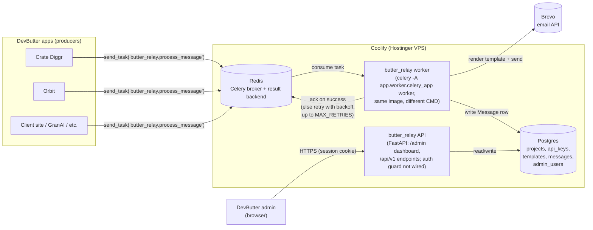
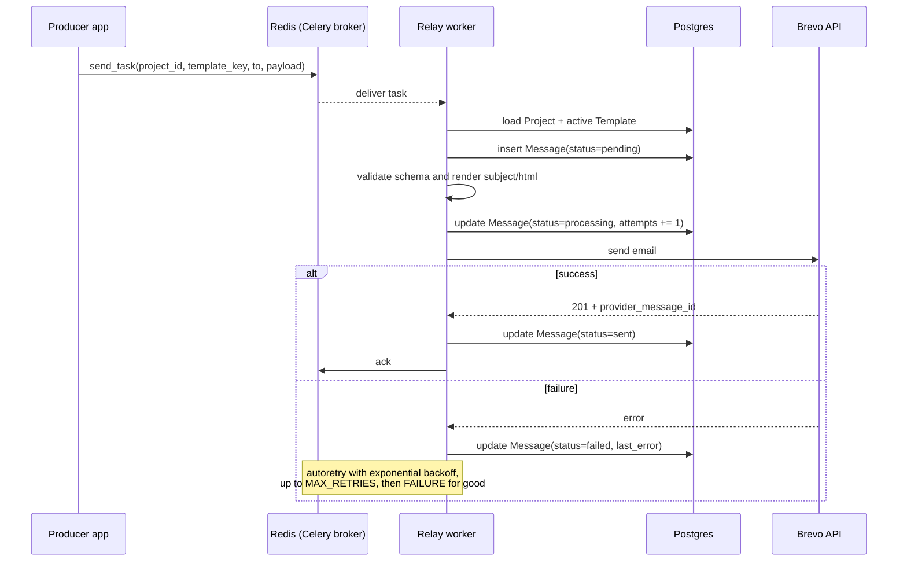
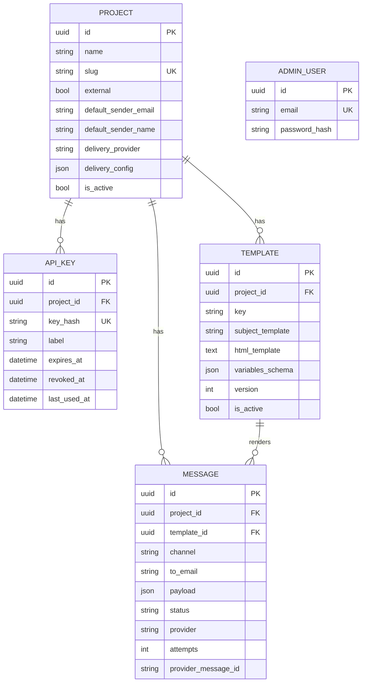

# Butter Relay

DevButter's company-wide, multi-tenant transactional email service. Apps publish "send this email" jobs as a Celery task; Butter Relay consumes them, renders a versioned Jinja2 template, dispatches through the company's own delivery channel (Brevo by default), and logs every attempt. A server-rendered admin dashboard lets the team manage projects, API keys, templates, and the message log without touching the database directly.

- **Multi-tenant**: one deployment serves every DevButter app/client (Crate Diggr, Orbit, GranAI, client sites, ...), each scoped as a `Project`.
- **Queue-driven**: [Celery](https://docs.celeryq.dev/) with a Redis broker, same Redis instance in every environment (Coolify-managed) — no per-environment queue emulation to keep in sync with production, unlike the ElasticMQ/SQS setup this replaced.
- **Per-company delivery channel**: each project picks how its mail leaves the relay — `brevo` (default everywhere) or `smtp` (Mailpit sandbox / own host) — in the admin or via API. Step-by-step: [`docs/GUIA_FLUXO_E_IMPLEMENTACAO.md`](docs/GUIA_FLUXO_E_IMPLEMENTACAO.md).
- **Email-only for now**: `Message.channel` defaults to `"email"` and is reserved for a future `in_app`/`push` channel, but no other delivery mechanism is built.
- **Providers**: [Brevo](https://www.brevo.com/) (default) and plain SMTP, behind an `EmailProvider` protocol and resolved per project by `get_email_provider_for_project`. A new channel = one class + one enum member + one factory branch.
- **Dashboard**: FastAPI + Jinja2 + HTMX, same Docker image and service layer as the API — no separate frontend build.

## Architecture

The current-state flow and security review is documented in
[`docs/butter-relay-fluxos.md`](docs/butter-relay-fluxos.md), with standalone Mermaid sources in
[`docs/diagrams/`](docs/diagrams/). Everything runs on Coolify (Hostinger VPS), prod and staging
alike — there is no AWS in this deployment.



### Message flow (sequence)



The Mermaid above reflects the Redis/Celery worker. The checked-in `.mmd` sources in
[`docs/diagrams/`](docs/diagrams/) are a snapshot from the SQS-era security audit
([`docs/auditoria-seguranca-2026-08-29.md`](docs/auditoria-seguranca-2026-08-29.md)) and are left
as historical record rather than rewritten here — don't read them as the current architecture.

### Data model



`Template(project_id, key, version)` is unique — publishing a new version deactivates the prior active one. `ApiKey.key_hash` and `Project.slug` are also unique; violations surface as HTTP `409`.

## Tech stack

| Layer | Choice |
|---|---|
| Framework | FastAPI (async), Poetry-managed |
| Persistence | SQLAlchemy 2.0 (async) + Alembic, Postgres |
| Queue | Celery, Redis broker + result backend — same Redis in every environment |
| Templates | Jinja2 `SandboxedEnvironment` (template bodies are user-authored content) |
| Email provider | Per project: Brevo (default) or SMTP (`core/email_provider.py`, `EmailProvider` protocol) |
| Dashboard | Jinja2 + HTMX, session-cookie auth (`bcrypt` + `itsdangerous`) |
| Testing | `pytest` + `httpx.AsyncClient`, in-memory SQLite |

## Project structure

```
app/
├── main.py                # FastAPI() wiring: middleware, exception handlers, routers
├── settings/               # config.py (env), logging_config.py, middleware.py
├── core/                   # dependencies.py, decorators.py (log_call/log_errors),
│                           # exceptions.py (self-registering handlers), email_provider.py
├── db/                     # base.py, session.py, all_models.py (for Alembic autogenerate)
├── projects/                # router/schemas/models/service/repository/dependencies
├── api_keys/                 # scoped credentials per project (+ CurrentApiKey auth dep)
├── templates_/                # email templates (subject + Jinja2 html body, versioned)
├── messages/                  # one row per send attempt = the email log
├── auth/                       # AdminUser, login/logout, session dependency
├── admin/                       # Jinja2+HTMX dashboard (router.py + templates/)
└── worker/                       # Celery app + task (celery -A app.worker.celery_app worker)
alembic/                    # migrations
docs/diagrams/              # .mmd sources for the diagrams above
scripts/curl_smoke_test.sh  # end-to-end curl smoke test
tests/                      # pytest suite
```

Each domain package (`projects`, `api_keys`, `templates_`, `messages`, `auth`) follows the same six-file shape: `router.py`, `schemas.py`, `models.py`, `service.py`, `repository.py`, `dependencies.py`. `dependencies.py` holds the domain's DI wiring — `get_*_service` factories + their `Annotated[..., Depends(...)]` aliases, plus the auth deps the domain owns (`auth/` owns `CurrentAdminUser`/`CurrentAdminUserApi`; `api_keys/` owns `CurrentApiKey`). A domain that needs another's DI imports from `app.<owner>.dependencies`, never from `app.<owner>.router`; `core/dependencies.py` keeps only `DbSession`.

## Step-by-step: run it locally

### 1. Prerequisites

- Docker + Docker Compose
- (optional, for running things outside Docker) Python 3.11 and [Poetry](https://python-poetry.org/)

### 2. Configure environment

```bash
cp .env.example .env
```

The shared development PostgreSQL is started by `../infra/docker-compose.yml` as `shared-postgres`.
The defaults already point at `shared-postgres` and `redis`. Every project sends through Brevo by
default, so set `BREVO_API_KEY` for real sends (otherwise expect a `401`), or switch a project to the
`smtp` channel in the admin to land its mail in Mailpit.

### 3. Bring up the stack

```bash
docker compose --profile dev up -d --build
```

The shared development PostgreSQL is started from `../infra/docker-compose.yml`. This stack starts
the Redis, API, and worker containers:

| Service | Purpose | Local port |
|---|---|---|
| `redis` | Celery broker/result backend for local dev | `6379` |
| `mailpit` | SMTP server and web UI for local emails | `1025`, `8025` |
| `api` | FastAPI app (dashboard + JSON API), auto-reload | `8010` → `8000` |
| `worker` | Celery worker (`celery -A app.worker.celery_app worker`) | — |

Check everything is up:

```bash
docker compose ps
curl -s http://localhost:8010/health
```

Mailpit: http://localhost:8025

### 4. Apply the database migration

```bash
docker compose exec api alembic upgrade head
```

(Or from the host, if you have Poetry installed and Postgres reachable on `localhost:5436`:
`DATABASE_HOST=localhost DATABASE_PORT=5436 DATABASE_USER=relay DATABASE_PASSWORD=relay DATABASE_NAME=relay poetry run alembic upgrade head`)

### 5. Create the first admin user

There's no public self-registration endpoint (closed API) — bootstrap one via the running container:

```bash
docker compose exec -T api python -c "
import asyncio
from app.auth.repository import AdminUserRepository
from app.auth.service import AuthService
from app.db.session import session_factory

async def main():
    async with session_factory() as session:
        await AuthService(AdminUserRepository(session)).register(
            'admin@devbutter.com', 'Test@123'
        )

asyncio.run(main())
"
```

### 6. Log into the dashboard

Open [http://localhost:8010/admin](http://localhost:8010/admin), sign in with the credentials from step 5, then:

1. **Projects** → create a project (name, slug, default sender, **delivery channel** Brevo/SMTP, optional **External** checkbox). On the project page, **Settings & delivery channel** edits all of it and **Send test** verifies the channel.
   Each project gets its own Celery queue derived from its slug (`relay-<slug>`, see
   `Project.queue_name`) — no queue URL to type in. External projects' API keys expire 30 days
   after creation; internal ones don't expire until revoked.
2. Open the project → **Generate key** to create an API key (shown once — copy it).
3. Still on the project page → **Publish new version** to create a template (Jinja2 `subject_template` + `html_template`, optional `variables_schema`). Invalid Jinja/schema is rejected; **Edit as new version** and **Activate** (rollback) manage versions.
4. **Messages** shows the log of every send attempt, with a filter by project/status and a **Resend** action on failed messages.

### 7. Send a test message through the queue

Producer apps publish by calling `send_task` against the shared Redis broker (not via the
dashboard). Each project has its own queue (`project.queue_name`, e.g. `relay-crate-diggr`) that
the worker starts consuming automatically as soon as the project is created — no restart needed.
The legacy `relay-shared` queue below still works for producers that haven't been updated to pass
a per-project `queue=`. To simulate one locally:

```bash
PROJECT_ID="<uuid from step 6>"

docker compose exec -T api python -c "
from celery import Celery
celery = Celery('smoke-test', broker='redis://redis:6379/0')
celery.send_task(
    'butter_relay.process_message',
    kwargs={
        'project_id': '$PROJECT_ID',
        'template_key': 'welcome_email',
        'to': 'test@example.com',
        'payload': {'name': 'Marcos'},
    },
    queue='relay-shared',
)
"
```

Watch the worker pick it up:

```bash
docker compose logs -f worker
```

When the stack and dependencies are actually running, the message should appear in **/admin/messages** as `sent` (with a real `BREVO_API_KEY`) or `failed` (401, if unset). This exercises the local Redis → render → send → log path; it does not prove production readiness or exactly-once delivery.

### 8. Run the automated tests

```bash
poetry install
poetry run pytest
```

Covers: endpoint CRUD + `409` conflict cases for projects/templates, template versioning and JSON-schema payload validation, auth login/session flows, the `log_call`/`log_errors` decorators, and a worker unit test with a mocked Brevo provider (success, provider failure, malformed task args) — `process_message` is tested directly, bypassing Celery's own dispatch, same as the SQS receive-loop was bypassed before.

### 9. Run the curl smoke test

With the stack from step 3 running:

```bash
./scripts/curl_smoke_test.sh
```

Exercises the real HTTP surface end-to-end: health check, admin login/session, project/template/API-key creation via the JSON API, template preview rendering, and the message log — printing `OK`/`FAIL` per check plus a pass/fail summary. Idempotent: safe to re-run against a stack that already has data (existing project/admin user are reused, not treated as failures).

## Environment variables

| Variable | Default | Notes |
|---|---|---|
| `DEBUG` | `false` | Relaxes cookie `Secure` flag when true |
| `LOG_LEVEL` | `INFO` | |
| `DATABASE_HOST` / `PORT` / `USER` / `PASSWORD` / `NAME` | `shared-postgres` / `5432` / `relay` | Pydantic monta `postgresql+asyncpg://` |
| `REDIS_URL` | `redis://redis:6379/0` | Celery broker + result backend; producers must point at this same instance |
| `RELAY_QUEUE_NAME` | `relay-shared` | Celery queue the worker consumes from |
| `BREVO_API_KEY` | — | Required outside development; used by every project on the `brevo` channel |
| `SMTP_HOST` / `SMTP_PORT` | `mailpit` / `1025` | Defaults for projects on the `smtp` channel (overridable per project) |
| `SESSION_SECRET` | dev-only placeholder | Set a real secret in production |

## Producer contract (Celery task shape)

Producers call `send_task` against the shared Redis broker (see step 7 above for a full example) —
no import of this repo's code, just matching the task name and kwargs. The project's delivery channel is applied by the worker — producers never choose it:

```python
celery.send_task(
    "butter_relay.process_message",
    kwargs={
        "project_id": "<uuid string>",
        "template_key": "welcome_email",
        "to": "user@example.com",
        "payload": {"name": "Marcos"},
    },
    queue="relay-shared",
)
```

`project_id` (string UUID) identifies the tenant — this is how the worker resolves which
`Project`/`Template` to use without a second auth hop. Redis access itself is authorized at the
network level (Coolify's internal network), not an API key.

## Deploying (Coolify)

Everything runs on Coolify, prod and staging alike — see
[`docker-compose.hostinger.yml`](docker-compose.hostinger.yml).

- **`relay-api`**: `uvicorn app.main:app` — the API/dashboard.
- **`relay-worker`**: `celery -A app.worker.celery_app:celery_app worker --loglevel=info` — same image, different `command`.
- **Postgres**: a Coolify-managed instance, via `DATABASE_HOST` / `PORT` / `USER` / `PASSWORD` / `NAME`.
- **Redis**: a Coolify-managed instance, via `REDIS_URL`. Retries with exponential backoff
  (`autoretry_for`, `MAX_RETRIES` in `app/worker/tasks.py`) replace the SQS redrive-policy-to-DLQ
  this used to depend on — a failed task ends in `Message.status=failed` in Postgres rather than a
  separate dead-letter queue, so **/admin/messages** is where to look for stuck sends.
- Secrets (`DATABASE_PASSWORD`, `BREVO_API_KEY`, `SESSION_SECRET`) are set as Coolify environment
  variables on each service, not fetched from a secrets manager.

## Roadmap notes

- **Amazon SES** and per-company Brevo keys / authenticated SMTP: not built; see "Ainda não implementado" in [`docs/GUIA_FLUXO_E_IMPLEMENTACAO.md`](docs/GUIA_FLUXO_E_IMPLEMENTACAO.md).
- **In-app/push notifications**: explicitly out of scope for now. `Message.channel` defaults to `"email"` and exists so a future channel doesn't require a schema migration — no other delivery mechanism is implemented.
